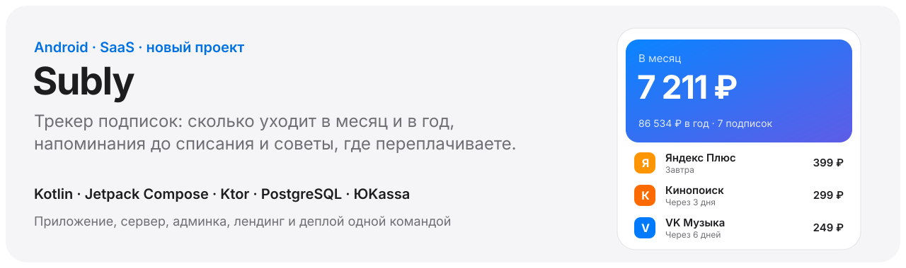
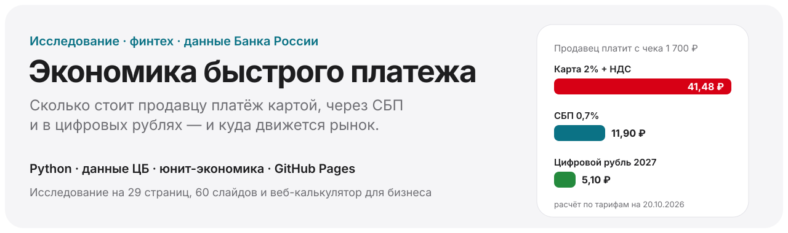
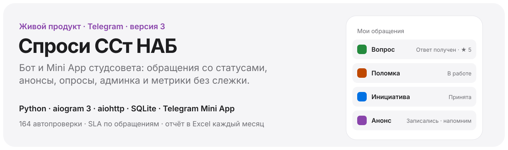

<picture>
  <source media="(prefers-color-scheme: dark)" srcset="assets/header-dark.svg">
  
</picture>

Учусь на программной инженерии в Финансовом университете. Делаю продукты, которыми пользуются люди: Telegram-боты и Mini App для студенческих проектов, сайты на заказ. Больше всего мне интересно, что с этими продуктами происходит потом, поэтому я занимаюсь аналитикой: метриками, экспериментами и экономикой.

Ищу стажировку продуктового или антифрод-аналитика.

&nbsp;

## Проекты

<a href="https://github.com/antonshkelll/Subly"><picture><source media="(prefers-color-scheme: dark)" srcset="assets/subly-dark.svg"></picture></a>

<a href="https://github.com/antonshkelll/sbp-economics"><picture><source media="(prefers-color-scheme: dark)" srcset="assets/sbp-dark.svg"></picture></a>

<a href="https://antonshkelll.github.io/sbp-economics/">Калькулятор: сколько ваш бизнес платит за приём денег</a> · <a href="https://github.com/antonshkelll/sbp-economics/tree/main/research">исследование</a> · <a href="https://github.com/antonshkelll/sbp-economics/tree/main/presentation">презентация</a>

  <a href="https://github.com/antonshkelll/splitlab-bnpl-analytics"><picture><source media="(prefers-color-scheme: dark)" srcset="assets/splitlab-dark.svg"></picture></a>
  <a href="https://github.com/antonshkelll/uplift-targeting"><picture><source media="(prefers-color-scheme: dark)" srcset="assets/uplift-dark.svg"></picture></a>

  <a href="https://github.com/antonshkelll/drophunter-antifraud"><picture><source media="(prefers-color-scheme: dark)" srcset="assets/drophunter-dark.svg"></picture></a>
  <a href="https://github.com/antonshkelll/txgpt-llm-from-scratch"><picture><source media="(prefers-color-scheme: dark)" srcset="assets/txgpt-dark.svg"></picture></a>

  <a href="https://github.com/antonshkelll/finpilot-mcp"><picture><source media="(prefers-color-scheme: dark)" srcset="assets/finpilot-dark.svg"></picture></a>
  <a href="https://github.com/antonshkelll/ru-market-pulse"><picture><source media="(prefers-color-scheme: dark)" srcset="assets/pulse-dark.svg"></picture></a>

&nbsp;

## Сегодня на рынке

<a href="https://github.com/antonshkelll/ru-market-pulse"><picture><source media="(prefers-color-scheme: dark)" srcset="assets/market-dark.svg"></picture></a>

Карточку каждую ночь перерисовывает GitHub Actions по свежим данным Московской биржи из проекта «Пульс рынка».

&nbsp;

## Живые продукты

<a href="https://github.com/antonshkelll/nab-bot"><picture><source media="(prefers-color-scheme: dark)" srcset="assets/nab-dark.svg"></picture></a>

**[Спроси ССт НАБ](https://t.me/sprosinab_bot)** — бот и Telegram Mini App Студсовета факультета. В версии 3 обращения стали тикетами со статусами и перепиской, появились анонимность с шифрованием связи с автором, контроль сроков ответа, анонсы с записью и напоминаниями, опросы, новости, админка прямо в Mini App и ежемесячный отчёт в Excel. Метрики считаются без слежки: уникальные пользователи хранятся только как хеши с солью периода.
[Бот](https://github.com/antonshkelll/nab-bot) · [Mini App](https://github.com/antonshkelll/nab-app)

**[antonshkel.ru](https://antonshkel.ru)** — сайт-портфолио и четыре концепт-сайта на чистом HTML/CSS/JS, своя форма заявок, 152-ФЗ, Яндекс Метрика.
[Код](https://github.com/antonshkelll/antonshkel.ru)

&nbsp;

## Чем пользуюсь

SQL (PostgreSQL, DuckDB) · Python: pandas, SciPy, statsmodels, scikit-learn, PyTorch · A/B-тесты и causal inference · Kotlin: Jetpack Compose, Ktor · aiogram, Django · Docker, GitHub Actions

## Резюме

[На русском (PDF)](resume/Anton_Shkel_Resume_RU.pdf) · [In English (PDF)](resume/Anton_Shkel_Resume_EN.pdf)

## Связаться

[anton.shkel06@mail.ru](mailto:anton.shkel06@mail.ru) · [Telegram](https://t.me/antonshkelll) · [antonshkel.ru](https://antonshkel.ru)
