<picture>
  <source media="(prefers-color-scheme: dark)" srcset="assets/header-dark.svg">
  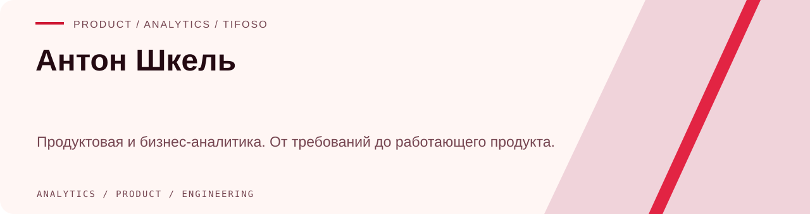
</picture>

Учусь на программной инженерии в Финансовом университете. Соединяю продуктовую и бизнес-аналитику с разработкой: разбираюсь в задаче, описываю требования, собираю интерфейс и интеграции, проверяю результат данными. В проектах работаю с SQL, Python, экспериментами, антифродом и AI-ассистентами.

Мне интересно пройти весь путь: от «зачем это пользователю?» до работающего продукта и понятного ответа на вопрос «что изменилось после запуска?».

**Ищу стажировку в продуктовой, бизнес- или антифрод-аналитике.** Открыт к задачам на стыке данных, продукта и Python-разработки.

Вне проектов: Ferrari, Formula 1 и немного командного радио 🟡

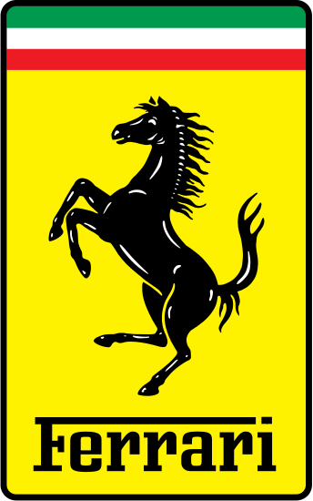 &nbsp; 

**Melbourne 2025 / race radio**

> Leclerc: “I have the seat full of water!”
>
> Bozzi: “Must be the water.”
>
> Leclerc: “Let’s add that to the words of wisdom.”

[Оригинальная история: Formula 1](https://www.formula1.com/en/latest/article/funniest-moment-best-radio-message-and-much-more-f1s-2025-alternative-awards.1IRqxCvFzhvzMJQmMdQwpp.1IRqxCvFzhvzMJQmMdQwpp). Личный фан-блок; товарные знаки принадлежат правообладателям. Проекты не связаны с Ferrari или Formula 1.

&nbsp;

## Проекты

<a href="https://github.com/antonshkelll/alfa-hack-2026-ai-credit-cabinet"><picture><source media="(prefers-color-scheme: dark)" srcset="assets/alfa-dark.svg">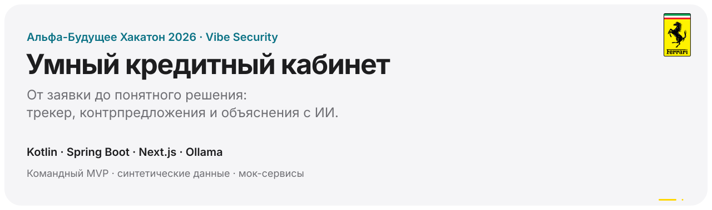</picture></a>

Командный MVP для кредитования малого бизнеса. Мой вклад: продуктовая проработка, сценарии и тексты интерфейса, мок-сервисы внешних источников и синтетические данные.

<a href="https://github.com/antonshkelll/opora-psb"><picture><source media="(prefers-color-scheme: dark)" srcset="assets/opora-dark.svg">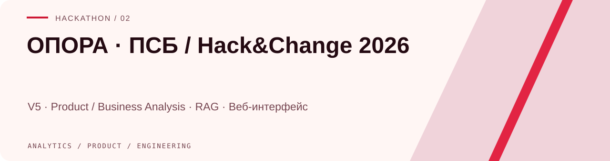</picture></a>

**ОПОРА · Hack&Change 2026 / ПСБ. Итоговая версия: V5.** Мои роли: Product / Business Analyst, архитектор и разработчик интерфейса. Постановка задачи, требования и критерии приёмки; пользовательские сценарии; RAG и интеграция; веб-интерфейс, проверка качества, упаковка и защита. [Решение](https://github.com/antonshkelll/opora-psb) · [Демонстрация](https://antonshkelll.github.io/opora-psb/) · [Презентация](https://antonshkelll.github.io/opora-psb/deck.html) · [Выполненная работа](https://github.com/antonshkelll/opora-psb/blob/main/docs/WORK_DONE.md)

<a href="https://github.com/antonshkelll/Subly"><picture><source media="(prefers-color-scheme: dark)" srcset="assets/subly-dark.svg">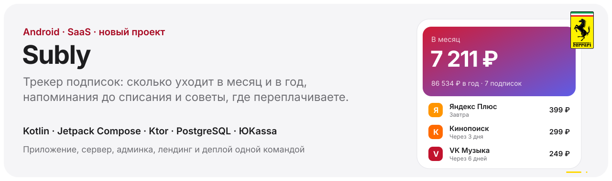</picture></a>

<a href="https://github.com/antonshkelll/sbp-economics"><picture><source media="(prefers-color-scheme: dark)" srcset="assets/sbp-dark.svg">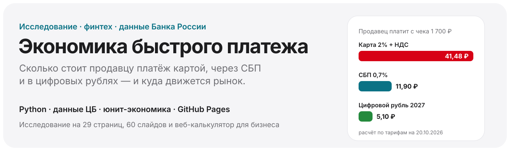</picture></a>

<a href="https://antonshkelll.github.io/sbp-economics/">Калькулятор: сколько ваш бизнес платит за приём денег</a> · <a href="https://github.com/antonshkelll/sbp-economics/tree/main/research">исследование</a> · <a href="https://github.com/antonshkelll/sbp-economics/tree/main/presentation">презентация</a>

  <a href="https://github.com/antonshkelll/splitlab-bnpl-analytics"><picture><source media="(prefers-color-scheme: dark)" srcset="assets/splitlab-dark.svg">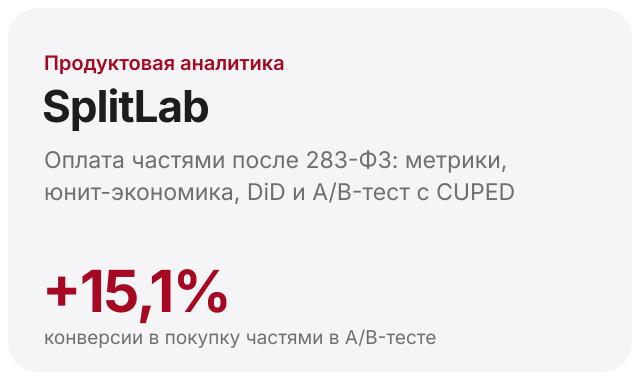</picture></a>
  <a href="https://github.com/antonshkelll/uplift-targeting"><picture><source media="(prefers-color-scheme: dark)" srcset="assets/uplift-dark.svg">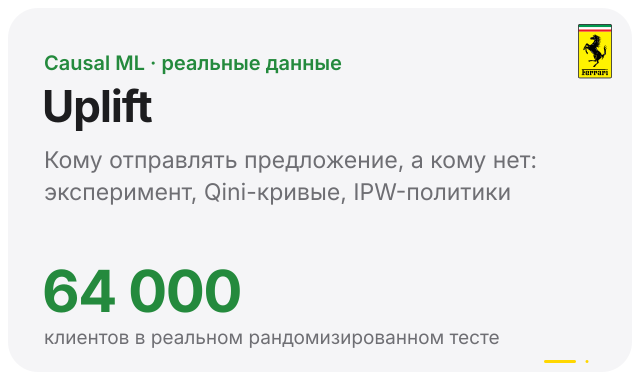</picture></a>

  <a href="https://github.com/antonshkelll/drophunter-antifraud"><picture><source media="(prefers-color-scheme: dark)" srcset="assets/drophunter-dark.svg">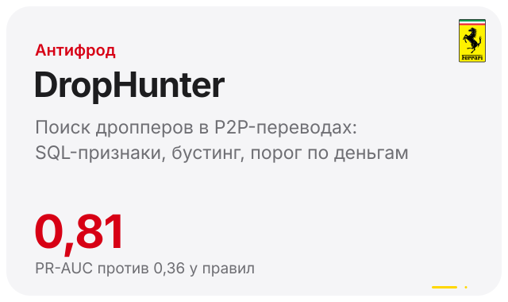</picture></a>
  <a href="https://github.com/antonshkelll/txgpt-llm-from-scratch"><picture><source media="(prefers-color-scheme: dark)" srcset="assets/txgpt-dark.svg">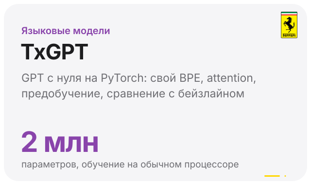</picture></a>

  <a href="https://github.com/antonshkelll/finpilot-mcp"><picture><source media="(prefers-color-scheme: dark)" srcset="assets/finpilot-dark.svg">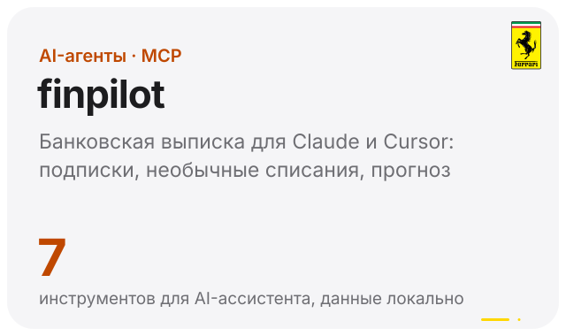</picture></a>
  <a href="https://github.com/antonshkelll/ru-market-pulse"><picture><source media="(prefers-color-scheme: dark)" srcset="assets/pulse-dark.svg">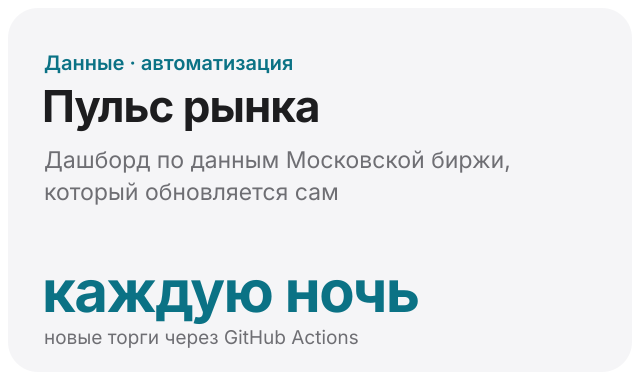</picture></a>

### Учебные проекты

<a href="https://github.com/antonshkelll/marketlens-coursework"><picture><source media="(prefers-color-scheme: dark)" srcset="assets/marketlens-dark.svg">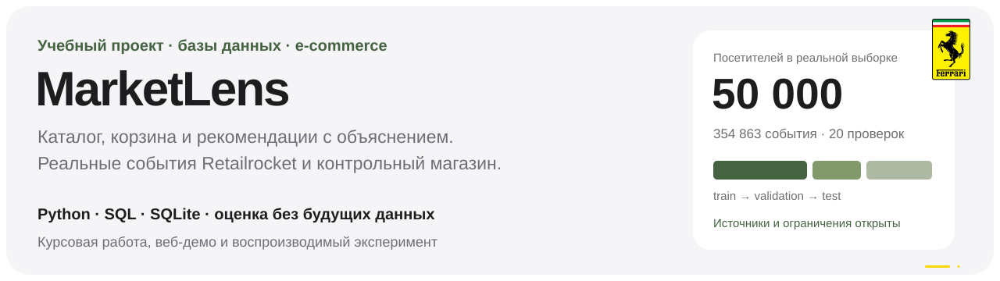</picture></a>

<a href="https://antonshkelll.github.io/marketlens-coursework/">Открыть демо</a> · <a href="https://github.com/antonshkelll/marketlens-coursework/tree/main/research">курсовая работа</a> · <a href="https://github.com/antonshkelll/marketlens-coursework/blob/main/DATA_SOURCES.md">происхождение данных</a>

&nbsp;

## Сегодня на рынке

<a href="https://github.com/antonshkelll/ru-market-pulse"><picture><source media="(prefers-color-scheme: dark)" srcset="assets/market-dark.svg">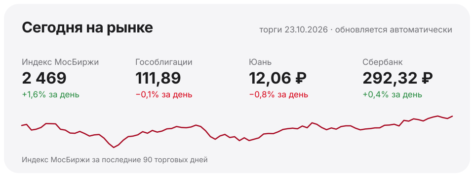</picture></a>

Карточку каждую ночь перерисовывает GitHub Actions по свежим данным Московской биржи из проекта «Пульс рынка».

&nbsp;

## Живые продукты

<a href="https://github.com/antonshkelll/nab-bot"><picture><source media="(prefers-color-scheme: dark)" srcset="assets/nab-dark.svg">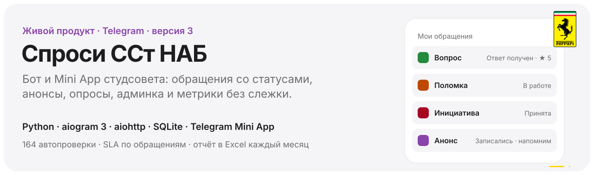</picture></a>

[Спроси ССт НАБ](https://t.me/sprosinab_bot) — бот и Telegram Mini App Студсовета факультета. В версии 3 обращения стали тикетами со статусами и перепиской, появились анонимность с шифрованием связи с автором, контроль сроков ответа, анонсы с записью и напоминаниями, опросы, новости, админка прямо в Mini App и ежемесячный отчёт в Excel. Метрики считаются без слежки: уникальные пользователи хранятся только как хеши с солью периода.
[Бот](https://github.com/antonshkelll/nab-bot) · [Mini App](https://github.com/antonshkelll/nab-app)

[antonshkel.ru](https://antonshkel.ru) — сайт-портфолио и четыре концепт-сайта на чистом HTML/CSS/JS. На сайте своя форма заявок, 152-ФЗ и Яндекс Метрика.
[Код](https://github.com/antonshkelll/antonshkel.ru)

&nbsp;

## Чем пользуюсь

Языки: Python, SQL, Kotlin, JavaScript, HTML/CSS, Bash

SQL (PostgreSQL, DuckDB) · Python: pandas, SciPy, statsmodels, scikit-learn, PyTorch · A/B-тесты и causal inference · Kotlin: Jetpack Compose, Ktor · aiogram, Django · WireMock, Docker, GitHub Actions

## Резюме

[На русском (PDF)](resume/Anton_Shkel_Resume_RU.pdf) · [In English (PDF)](resume/Anton_Shkel_Resume_EN.pdf)

## Связаться

[anton.shkel06@mail.ru](mailto:anton.shkel06@mail.ru) · [Telegram](https://t.me/antonshkelll) · [antonshkel.ru](https://antonshkel.ru)
